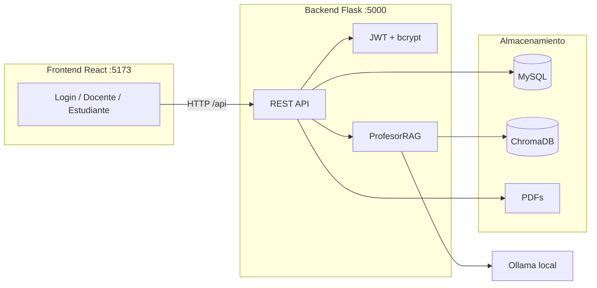

# Profesor IA

Plataforma de evaluación educativa con inteligencia artificial. Los docentes cargan materiales en PDF por asignatura y los estudiantes practican con preguntas generadas automáticamente a partir de ese contenido.

El proyecto está dividido en dos partes:

- **Backend** — API REST con Flask
- **Frontend** — interfaz web con React y Vite

## Características

- Autenticación JWT con roles de **docente** y **estudiante**
- Creación de asignaturas y carga de PDFs por curso
- **Evaluaciones configurables** — el docente elige tema y número de preguntas
- Indexación vectorial con ChromaDB (RAG)
- Generación de preguntas con Ollama a partir del material del docente
- Evaluación automática de respuestas con retroalimentación
- **Exportación a PDF** de los resultados al finalizar una evaluación

## Arquitectura



## Requisitos previos

| Herramienta | Versión recomendada | Notas |
|-------------|---------------------|-------|
| Python | 3.12 o 3.14 | Usa siempre un entorno virtual (`venv`) |
| Node.js | 18+ | Para el frontend |
| MySQL | 8+ | Recomendado en producción |
| Ollama | Última | [ollama.com](https://ollama.com/) — generación y embeddings |

---

## Despliegue e instalación

### 1. Clonar el repositorio

```bash
git clone https://github.com/joamontesgi/agente_ligred.git
cd agente_ligred
```

### 2. Modelos de Ollama (obligatorio)

Instala [Ollama](https://ollama.com/) y descarga los modelos **antes** de usar evaluaciones, labs o indexación de PDFs:

```bash
ollama pull qwen2.5:7b
ollama pull nomic-embed-text
```

Comprueba que Ollama esté en ejecución:

```bash
ollama list
curl http://127.0.0.1:11434/api/tags
```

| Modelo | Uso |
|--------|-----|
| `qwen2.5:7b` | Generación de preguntas, evaluación y chat de laboratorios |
| `nomic-embed-text` | Embeddings para ChromaDB (RAG) |

Puedes cambiar los modelos en `backend/.env` con `DEFAULT_LLM_MODEL` y `EMBEDDING_MODEL`.

### 3. Backend (Flask API)

```bash
cd backend

# Entorno virtual (recomendado)
python -m venv venv
venv\Scripts\activate          # Windows
# source venv/bin/activate     # Linux/macOS

pip install -r requirements.txt

# Variables de entorno
copy .env.example .env           # Windows
# cp .env.example .env           # Linux/macOS
# Edita .env: JWT_SECRET, MySQL, CORS_ORIGINS, Ollama

# Base de datos MySQL
python setup_mysql.py

# Arrancar API
python app.py
```

API en **todas las interfaces** (`0.0.0.0:5000`): en esta máquina `http://localhost:5000`; en la red `http://<IP-LAN>:5000`. Health check: `GET /api/health`.

**Variables en `backend/.env`:**

| Variable | Ejemplo | Descripción |
|----------|---------|-------------|
| `JWT_SECRET` | `mi-clave-segura` | Clave para firmar tokens (cámbiala en producción) |
| `JWT_EXPIRY_HOURS` | `24` | Expiración del token |
| `CORS_ORIGINS` | `*` | Orígenes del frontend (`*` en LAN; URLs concretas en producción pública) |
| `MYSQL_HOST` | `127.0.0.1` | Host MySQL |
| `MYSQL_PORT` | `3306` | Puerto MySQL |
| `MYSQL_USER` | `root` | Usuario MySQL |
| `MYSQL_PASSWORD` | `***` | Contraseña MySQL |
| `MYSQL_DATABASE` | `tutor` | Nombre de la base |
| `OLLAMA_BASE_URL` | `http://127.0.0.1:11434` | URL del servidor Ollama |
| `DEFAULT_LLM_MODEL` | `qwen2.5:7b` | Modelo LLM |
| `EMBEDDING_MODEL` | `nomic-embed-text` | Modelo de embeddings |

> Sin `MYSQL_DATABASE` ni `DATABASE_URL`, el backend usa SQLite en `data/app.db` (solo desarrollo).

**Producción (backend):** usa Gunicorn u otro WSGI, un `JWT_SECRET` fuerte y MySQL. Ejemplo:

```bash
pip install gunicorn
gunicorn -w 4 -b 0.0.0.0:5000 "app:create_app()"
```

Ollama debe estar accesible desde el servidor backend (misma máquina o URL remota en `OLLAMA_BASE_URL`).

### 4. Frontend (React + Vite)

```bash
cd frontend

npm install

# Desarrollo (proxy /api → backend en 127.0.0.1:5000)
npm run dev
```

Vite escucha en la red (`host: true`). En consola verás **Local** y **Network** (p. ej. `http://192.168.x.x:5173`). Otros equipos en la misma red pueden abrir esa URL; no hace falta `VITE_API_URL` (el proxy `/api` va al backend en el servidor).

**Producción (frontend):**

```bash
# Opcional: apuntar a la API en producción
copy .env.example .env
# Edita VITE_API_URL=https://tu-dominio.com/api

npm run build
```

Los archivos estáticos quedan en `frontend/dist/`. Sírvelos con Nginx, Apache, Vercel, Netlify, etc.

**Variable en `frontend/.env`:**

| Variable | Ejemplo | Descripción |
|----------|---------|-------------|
| `VITE_API_URL` | `https://api.ejemplo.com/api` | URL base de la API (en dev no hace falta; Vite usa proxy) |

En producción, configura también `CORS_ORIGINS` en el backend con la URL exacta del frontend.

### 5. Resumen de puertos

| Servicio | Puerto | URL (servidor) |
|----------|--------|----------------|
| Frontend (dev) | 5173 | `http://<IP-LAN>:5173` (Vite muestra la IP al arrancar) |
| Backend API | 5000 | `http://<IP-LAN>:5000` |
| Ollama | 11434 | Solo en el servidor (`127.0.0.1:11434`) |
| MySQL | 3306 | Solo en el servidor (`127.0.0.1:3306`) |

> **Firewall:** en Windows, permite entrar en los puertos **5173** y **5000** si otros PCs no conectan.

---

## Inicio rápido (desarrollo)

Necesitas **tres servicios** activos: **Ollama**, **backend** y **frontend**.

### Terminal 1 — Ollama

Asegúrate de que Ollama esté instalado y corriendo (normalmente arranca con el sistema tras instalarlo).

### Terminal 2 — Backend

```bash
cd backend
venv\Scripts\activate
python app.py
```

### Terminal 3 — Frontend

```bash
cd frontend
npm run dev
```

En desarrollo, Vite redirige las peticiones `/api` al backend en la misma máquina. Desde tablets u otros PCs usa la URL **Network** que imprime `npm run dev`.

## Uso

### Docente

1. Regístrate con tipo de cuenta **Docente**
2. Crea una asignatura (nombre y descripción)
3. Selecciona la asignatura y sube uno o más PDFs
4. Pulsa **Procesar documentos** para indexarlos en ChromaDB

### Estudiante

1. Regístrate con tipo de cuenta **Estudiante**
2. Ve a **Inscribirme** y elige una asignatura
3. En **Practicar**, selecciona la asignatura y pulsa **Nueva pregunta**
4. Escribe tu respuesta y envíala para recibir la evaluación

## Estructura del proyecto

```
agente/
├── backend/
│   ├── app.py              # Punto de entrada Flask
│   ├── config.py           # Rutas de datos y variables de entorno
│   ├── jwt_utils.py        # Tokens JWT y decoradores de auth
│   ├── auth.py             # Lógica de usuarios, asignaturas e inscripciones
│   ├── models.py           # Modelos SQLAlchemy
│   ├── database.py         # Conexión MySQL / SQLite
│   ├── rag.py              # Generación de preguntas y evaluación
│   ├── ingest.py           # Lectura de PDFs e indexación
│   ├── prompts.py          # Prompts del profesor virtual
│   ├── requirements.txt
│   └── routes/
│       ├── auth.py         # /api/auth/*
│       ├── subjects.py     # /api/subjects/*
│       └── practice.py     # /api/practice/*
│
├── frontend/
│   ├── index.html
│   ├── vite.config.js      # Proxy /api → localhost:5000
│   ├── package.json
│   └── src/
│       ├── App.jsx         # Rutas y protección por rol
│       ├── api/client.js   # Cliente HTTP
│       ├── context/        # AuthContext (JWT en localStorage)
│       ├── components/       # Layout
│       ├── pages/          # Login, Teacher, Student
│       └── styles/
│
├── data/                   # SQLite local (solo si no usas MySQL)
├── documentos/             # PDFs subidos por asignatura
└── chroma/                 # Base vectorial persistente
```

## API REST

Base URL: `http://localhost:5000/api`

Las rutas protegidas requieren el header:

```
Authorization: Bearer <token>
```

### Auth

| Método | Ruta | Auth | Descripción |
|--------|------|------|-------------|
| POST | `/auth/register` | No | Crear cuenta |
| POST | `/auth/login` | No | Iniciar sesión |
| GET | `/auth/me` | Sí | Usuario autenticado |

**Registro** — `POST /auth/register`

```json
{
  "nombre": "Ana García",
  "email": "ana@ejemplo.com",
  "password": "123456",
  "role": "student"
}
```

Respuesta `201`:

```json
{
  "token": "eyJ...",
  "user": { "id": 1, "email": "ana@ejemplo.com", "nombre": "Ana García", "role": "student" }
}
```

**Login** — `POST /auth/login`

```json
{
  "email": "ana@ejemplo.com",
  "password": "123456"
}
```

### Asignaturas

| Método | Ruta | Rol | Descripción |
|--------|------|-----|-------------|
| GET | `/subjects/mine` | Docente | Asignaturas del docente |
| POST | `/subjects/` | Docente | Crear asignatura |
| GET | `/subjects/` | Cualquiera | Listar asignaturas |
| GET | `/subjects/enrollments` | Estudiante | Mis inscripciones |
| POST | `/subjects/{id}/enroll` | Estudiante | Inscribirse |
| GET | `/subjects/{id}/documents` | Docente | Documentos de una asignatura |
| POST | `/subjects/{id}/documents` | Docente | Subir PDFs (multipart) |

**Crear asignatura** — `POST /subjects/`

```json
{
  "name": "Cálculo I",
  "description": "Límites, derivadas e integrales"
}
```

**Subir documentos** — `POST /subjects/{id}/documents`

```
Content-Type: multipart/form-data
Campo: files (uno o más PDFs)
```

### Práctica

| Método | Ruta | Rol | Descripción |
|--------|------|-----|-------------|
| POST | `/practice/question` | Estudiante | Generar pregunta (práctica libre) |
| POST | `/practice/evaluate` | Estudiante | Evaluar respuesta (práctica libre) |

### Evaluaciones

| Método | Ruta | Rol | Descripción |
|--------|------|-----|-------------|
| POST | `/evaluations/` | Docente | Crear evaluación (tema + N preguntas) |
| GET | `/evaluations/?subject_id=` | Docente | Listar evaluaciones de una asignatura |
| GET | `/evaluations/available` | Estudiante | Evaluaciones disponibles |
| POST | `/evaluations/{id}/start` | Estudiante | Iniciar evaluación (genera preguntas) |
| POST | `/evaluations/attempts/{id}/submit` | Estudiante | Enviar respuestas y obtener resultados |
| GET | `/evaluations/attempts/{id}` | Estudiante | Ver resultados de un intento |
| GET | `/evaluations/attempts/{id}/pdf` | Estudiante | Descargar resultados en PDF |

**Crear evaluación** — `POST /evaluations/`

```json
{
  "subject_id": 1,
  "title": "Parcial 1 — Derivadas",
  "topic": "Derivadas e interpretación geométrica",
  "num_questions": 5
}
```

**Generar pregunta** — `POST /practice/question`

```json
{ "subject_id": 1 }
```

**Evaluar respuesta** — `POST /practice/evaluate`

```json
{
  "contexto": "...",
  "pregunta": "...",
  "respuesta": "..."
}
```

### Health check

| Método | Ruta | Descripción |
|--------|------|-------------|
| GET | `/health` | Estado del servidor |

## Variables de entorno

Plantillas incluidas en el repositorio:

- `backend/.env.example` → copiar a `backend/.env`
- `frontend/.env.example` → copiar a `frontend/.env` (solo producción)

El archivo `.env` **no se sube a Git** (está en `.gitignore`). Usa las plantillas `.env.example` como referencia.

Configúralas en el entorno del backend (opcional en desarrollo):

| Variable | Default | Descripción |
|----------|---------|-------------|
| `JWT_SECRET` | `dev-secret-change-me` | Clave para firmar tokens JWT |
| `JWT_EXPIRY_HOURS` | `24` | Horas de validez del token |
| `CORS_ORIGINS` | `*` | Orígenes permitidos (`*` o lista separada por comas) |
| `MYSQL_HOST` | `127.0.0.1` | Host MySQL (usa `127.0.0.1` en Windows si `localhost` falla) |
| `MYSQL_PORT` | `3306` | Puerto MySQL |
| `MYSQL_USER` | `profesor_ia` | Usuario MySQL |
| `MYSQL_PASSWORD` | — | Contraseña MySQL |
| `MYSQL_DATABASE` | `profesor_ia` | Nombre de la base (activa MySQL) |
| `DATABASE_URL` | — | URL completa (tiene prioridad sobre `MYSQL_*`) |
| `OLLAMA_BASE_URL` | `http://127.0.0.1:11434` | Servidor Ollama |
| `DEFAULT_LLM_MODEL` | `qwen2.5:7b` | Modelo para preguntas y evaluación |
| `EMBEDDING_MODEL` | `nomic-embed-text` | Modelo para embeddings RAG |

### MySQL (recomendado en producción)

1. **Instala MySQL** (Windows: [MySQL Installer](https://dev.mysql.com/downloads/installer/) o XAMPP/WAMP con MySQL).

2. **Configura `backend/.env`** (ya tienes `MYSQL_DATABASE=tutor`):

```env
MYSQL_HOST=localhost
MYSQL_PORT=3306
MYSQL_USER=root
MYSQL_PASSWORD=tu_password
MYSQL_DATABASE=tutor
```

3. **Inicia el servicio MySQL** (Servicios de Windows → MySQL, o desde XAMPP).

4. **Crea la base y las tablas** desde la carpeta `backend/`:

```bash
cd backend
python setup_mysql.py
```

5. **Arranca la API**:

```bash
python app.py
```

Comprueba la conexión en `GET http://localhost:5000/api/health` — debe responder `"engine": "mysql"` y `"connected": true`.

> Sin `MYSQL_DATABASE` ni `DATABASE_URL`, el backend usa SQLite en `data/app.db` (solo desarrollo).

El diseño incluye 13 tablas. Referencia SQL en `backend/schema.sql`.

### Métricas (docente)

| Método | Ruta | Descripción |
|--------|------|-------------|
| GET | `/metrics/subjects` | Asignaturas del docente |
| GET | `/metrics/subjects/{id}` | Resumen, sesiones de lab y evaluaciones |

En el panel docente, pestaña **Métricas**: chats, evidencias, puntuaciones y duración por estudiante.

En el frontend, puedes apuntar a otra URL de API con `VITE_API_URL` en `frontend/.env` (ver `frontend/.env.example`).

## Solución de problemas

| Problema | Solución |
|----------|----------|
| Error al instalar dependencias Python | Usa `python -m venv venv`, activa el venv e instala con `pip install -r requirements.txt`. En Python 3.14 se requieren las versiones del `requirements.txt` actual |
| Error al generar preguntas | Verifica que Ollama esté corriendo y los modelos descargados (`ollama list`) |
| "No hay documentos cargados" | El docente debe subir y procesar PDFs para esa asignatura |
| CORS en producción | Añade la URL del frontend en `CORS_ORIGINS` |
| Token inválido | Vuelve a iniciar sesión; el token expira a las 24 h por defecto |

## Stack tecnológico

| Capa | Tecnología |
|------|------------|
| Frontend | React 19, Vite, React Router |
| Backend | Flask, Flask-CORS, PyJWT |
| Base de datos | MySQL / SQLite + SQLAlchemy |
| Vector store | ChromaDB |
| Embeddings | Ollama `nomic-embed-text` |
| LLM | Ollama `qwen2.5:7b` |
| PDFs | PyMuPDF |
| Autenticación | bcrypt + JWT |
